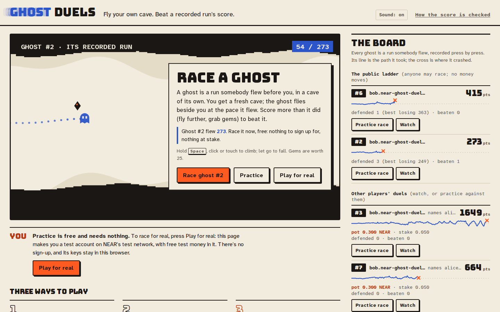
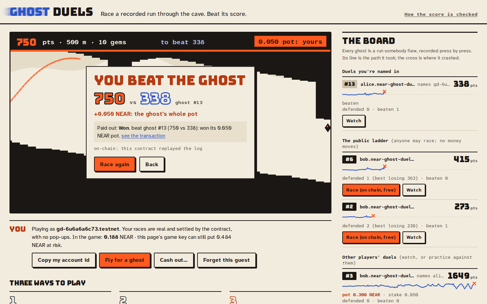

# Ghost Duels

**Live demo:** https://ghost-duels.rinalutful.dev (NEAR testnet, no sign-in).

**A skill game where the chain is the referee: the contract re-flies your button presses and pays
the pot in the same transaction. No score server to believe.** You fly a one-button cave; a "ghost"
is a run somebody recorded, with a pot on it. Score more than the ghost did and its pot is yours.
Staked races are private duels between players who chose each other; anyone can race the public
ladder, where no money moves.





Track: **Games With Real Economies**; also **NFTs That Do Something** (a ghost is an NFT that holds
a pot and earns its owner 70% of every failed challenge). NEAR testnet only: all money here is test
money. The hosted page and the video are linked from the repository's About box and the submission.
<!-- owner: hosted page URL and video URL go on the line above; the README reads correctly without them -->
<!-- owner: the submitter's other entry in this hackathon is named here: (fill in) -->

### Try it in three steps

1. `git clone https://github.com/rinalutful/ghost-duels && cd ghost-duels && npm ci`
2. `npm run judge`: free, no keys, no Rust, about a minute on a 2-CPU Linux box from a fresh clone.
   It ends in the table below with `4 passed, 0 failed, 0 skipped`. Its first row drives the
   committed contract wasm through the game's core loop in a NEAR host for Node.
3. `npm run web`, open http://localhost:5173 and press **Race ghost #N**: a free race, no account.
   Then **Play for real**: the page makes you a testnet guest account (keys stay in your browser)
   and the same race is settled by the contract: "Paid out: Won/Lost" with the transaction. For a
   staked duel, open a second browser: "Two players" below.

**Prerequisites.** **Node 22** (22.22 or newer: Vite 8 and near-api-js 7 need it; on Node 20 `npm
ci` skips Vite's native binding and the web build fails). Linux or macOS. That is all `npm run
judge` needs. `npm run judge:full` needs more: Rust through [rustup](https://rustup.rs) (the
contract pins Rust **1.93.0**; rustup fetches it on the first run) for the contract's unit tests,
the attack table and the mutants; [wasmtime](https://wasmtime.dev) for the kill test; Chromium's
system libraries for the page test (`npx playwright install --with-deps chromium-headless-shell`
on Ubuntu or Debian); and for the local-node sandbox, **Ubuntu 24.04 or any Linux with glibc ≥
2.38**, which NEAR's sandbox binary needs (it won't start on Debian 12).

**In Docker, one line** (Debian 12 with Node 22):

```sh
docker run --rm -v "$PWD":/src:ro node:22-bookworm bash -c 'mkdir /tmp/gd && cd /src && tar --exclude=./node_modules --exclude=./target -cf - . | tar -xf - -C /tmp/gd && cd /tmp/gd && npm ci && npm run judge'
```

**If the faucet says no.** "Play for real" asks NEAR's public testnet faucet for the guest account.
That faucet makes only a few accounts a day per network address and is sometimes down; the page
says so when it happens, and free races keep working. With a testnet account of your own (any
wallet), this plays for real without the faucet:
`PLAYER=you.testnet KEY_you_testnet=ed25519:… npm run session` (the variable is `KEY_` plus your
account id with dots and dashes as underscores; the key is read from the environment only). It
deposits 0.3 NEAR into the game, adds a function-call key capped at that, and prints the page's URL
for it.

### What `npm run judge` checks, and what it prints

| Step | Expect |
|---|---|
| **Core loop on the committed wasm** (`res/ghost_duels.wasm`, this source's build, in a NEAR host for Node; `npm run coreloop`): a pot and a stake are locked before the cave exists; `submit_run` sends button changes and the contract re-flies them and pays in the same call; the 70/25/5 split to the yocto; an edited score, a malformed log, a late submit and a stranger refused; a session key capped and unable to withdraw; the public ladder moves no money; a duel's pot is there when its challenger lands, and a pot swapped for a smaller one is refused; a failed withdrawal comes back; and balances + pots + storage = deposits − withdrawals | `All 25 core-loop checks passed.` |
| Page rules (who may race what, the duel form, invite links, `max_fee`, `min_pot` (the pot the page showed), the deadline guard, chain data never drawn as HTML) and the verifier's own rules | `17 passed` |
| Web app builds (tsc + vite) | `web/dist` |
| Testnet: the live contract (v4) runs its committed build `res/v4/ghost_duels.wasm` with no access keys; ghosts replay to their scores; every duel's list and every kept stake's split are what the contract guarantees; v1-v3 untouched | `All 12 checks passed.` |

**Not in the fast path, and the run says so:** the contract's 48 Rust unit tests (3 property
tests among them: money conserved, storage covered, a session key never loses more than its
cap), the attack table (32 attacks: 28 refused, 4 priced) and the sim's 6 unit tests. They need
near-sdk's test runtime compiled first, about three minutes on 2 CPUs by itself, so they moved to
`npm run judge:full` with the mutants. The core-loop row runs the same contract code as built and
committed, on fewer cases; it doesn't emulate gas, the protocol's access-key rules or exact storage
prices (`demo/wasm/host.ts` says what it does), which the local-node suite and testnet cover.

"Priced" means the attack goes through at a cost the test pins (fishing for a lucky cave, padding
a ghost's record from a second account, twice, and an owner keeping their own duel busy). The testnet step holds whatever players do to v4:
its checks are the contract's own guarantees (`demo/src/verify-rules.ts`), so a guest can't turn
this table to FAIL for the next person.

Measured in Docker (Debian 12, Node 22, 2 CPUs, 3 GB, a clean copy, `npm ci && npm run judge`):
**15 s** (`npm ci` 5 s, the judge 10 s), 4 passed. Each step prints its result the moment it finishes.

**`npm run judge:full`** adds the long suites (10-25 minutes): the contract's unit tests (`48
passed`), the attack table (`28 refused, 4 priced`), the sim's tests (`6 passed`), the kill test
(`PASS: 47/47 identical`, wasmtime), the mutants (`51/51 mutants caught`), the sandbox suite on a
local NEAR node (`All 60 checks passed.`) and the page in headless Chromium (`All 68 page checks
passed.`; its last pass plays for real against a mocked chain): `10 passed`.

> **Status: this source is v5; the live contract is v4**
>
> - **v5 (this source) is built, tested and not deployed.** It closes three limits of v4: a duel takes
>   one race at a time and its list can't change mid-race, so the ghost's owner can no longer take
>   the pot from under a challenger; a failed withdrawal comes back; and a qualifier that can start can always be submitted (0023).
>   A staked start can also name the pot it was shown (`min_pot`), so a pot swapped for a smaller
>   one is refused before anything is staked (0024).
>   Its build is
>   `res/ghost_duels.wasm`. Deploying it takes a new account and is one guarded command
>   (`npm run deploy-v5`); until then the page, the demos and `npm run verify` use v4
>   (`res/deploy.json`).
> - **Live: [`v4.near-ghost-duels-rywu8u.testnet`](https://testnet.nearblocks.io/address/v4.near-ghost-duels-rywu8u.testnet)**,
>   the committed build of v4's source (`res/v4/ghost_duels.wasm`, code hash `8VCbyhTJ…642A13`),
>   deployed, initialised and its only key deleted in [one transaction](https://testnet.nearblocks.io/txns/8seGfT7xfT4nBtpFePjfQ2d2MjBgSAQXpzzsuokcrHNe):
>   nobody can redeploy it or move its NEAR (0020). On it: `npm run demo -- --shared` 11/11,
>   `npm run cheat -- --shared` 11/11 refused, and the page's own buttons (`npm run page-e2e`).
> - **Staked play is a private duel** (0019): a staked ghost names its challengers and only they may
>   race it; ghosts with no pot are a public ladder where no money moves.
> - **Honest limit: a bot beats people.** Replay proves a score was flown from the submitted inputs,
>   not who flew it; a bot that sees only the screen flies a median 2461 against our model of a decent
>   human's 281 (0008). Duels keep bots out of the money of people who didn't choose them.
> - **Honest limit of the live v4: a duel's owner can take the pot first** (0022). While you race,
>   the ghost's owner can name a second account of theirs and have it win the pot before you land;
>   you then get your stake back, not the pot. v4 can't be changed; v5 refuses it. Until v5 is live,
>   duel people you trust.
> - **SIMULATED / not a TEE.** The OutLayer replay path is built and runs in the sandbox against a
>   **mock** of `outlayer.testnet`; v4 can't use it, on purpose (on-chain only).
> - Earlier deploys (v1 to v3) are history: [`docs/history.md`](docs/history.md).

## The problem

Skill games with money on the line die on one question: *did they really score that?* A client
reports a score and a server believes it. On a blockchain there is no server to believe. Ghost
Duels makes the score something anyone can recompute: the player commits a stake before their cave
exists, then submits only the ticks at which the button changed. The contract replays them.

The economy rests on that. A good run becomes a ghost (an NFT) that holds a pot; a challenger who
beats its score takes the pot; one who falls short pays its owner and grows the pot. Because a bot
flies better than people, the money is only between people who chose each other.

**You don't fly the ghost's cave.** Every run draws a fresh cave from the chain after its stake is
locked, so nobody (not the challenger, not a program) can rehearse it; the ghost flew a different
one. A race compares scores. On screen the ghost flies beside you at the pace and height it flew,
as a marker: it is not in your cave and passes through your rock. Caves differ in luck; difficulty
depends only on distance (0002).

## Two players: a staked duel from the page

1. Open the page in two browsers (or a normal and a private window), A and B, and press **Play for
   real** in each. In B, **Copy my account id** and give it to A.
2. A: **Fly for a ghost** → *Private duel*, paste B's id, pot 0.2, stake 0.05 → **Fly**. The pot is
   locked before the cave exists; 100+ points mint the ghost. Copy the invite link it shows.
3. B: open the link → "You're invited" → **Race ghost #N**. Beat its score and the pot is yours; fall
   short and A gets 70% of the stake (25% grows the pot, 5% to the house). The result says "Paid out:
   Won/Lost" with the transaction, and the replay's `via` ("on-chain: this contract replayed the log").

Then the ghost side, from **Your ghosts**: **Challengers…** (who may race it; an empty list closes
the duel), **Refill**, **Retire** (not within a day of minting or growth), **Give…** (NEP-171
transfer), **Invite link**; and **Cash out…** sends everything back to an account you name and
closes the guest. Each asks in the page, never in a browser prompt. `npm run page-e2e` does all of
this through the page's buttons in a headless browser, with the demo's scripted player alice as the
other side; it needs the deploy's funder key, because in that test the funder stands in for the
faucet (it creates the same account for the same public key the page generated).

## How NEAR is used, concretely

- **The referee is the contract.** `submit_run(run_id, log, claimed_score)` replays `log` with the
  `ghost-sim` crate linked into the contract and settles in the same call: refused if the claim
  differs, won if it beats the ghost, otherwise the stake is kept. 0.2-1.3 Tgas of replay.
- **A contract nobody holds.** v4's account has no access keys (deleted in the deploying
  transaction), so its code and its NEAR answer only to its methods.
- **Fresh caves from the chain.** `start_run` locks the stake (or a qualifier's pot) and only then
  draws the seed from `env::random_seed()`, so nobody knows the cave before committing; the run must
  be submitted within 90 s.
- **Guest accounts and session keys.** The page makes a testnet account from NEAR's public faucet
  service for a key pair it generated, then adds a **function-call key** limited to the game's
  methods and caps it with `set_key_cap`: races are signed with that key, with no prompts. It can't
  withdraw, transfer a ghost or name who may race your money (those need the full-access key and 1
  yoctoNEAR), and the contract refuses it past its cap, counting stakes, pots, fees and every byte its
  runs store (0010, 0020).
- **Ghosts are NEP-171/177/181 tokens** whose metadata is computed from the live record: score,
  defences, best losing challenge, earned, pot growth and rake paid, who may race it, and a plain
  statement that a record can be faked from a second account.
- **Storage is paid by whoever adds it** (0011), measured on every path, with a refundable per-run
  reserve for settlement. A "free" ladder race still costs its player about 0.006 NEAR of storage
  for the run's record.
- **OutLayer** (`request_execution` with yield/resume, the job pinned by sha256) and a **registered
  runner** are the other two replay modes, for a deploy made to allow them; anything they fail to
  settle is replayed on-chain (0012). v4 is on-chain only, and OutLayer has only run against a mock.

```
 browser (sim-web wasm)               Ghost Duels v4 contract
 guest key (full access), once: ───▶ deposit; set_key_cap(game key, 0.5 NEAR)
 full access, 1 yocto:              start_run(qualify: {pot, stake, challengers: [B]})
                                      the pot is locked before the cave exists; 100+ points mint a duel ghost
 B's game key: start_run(ghost) ───▶ only a named challenger may; locks the stake;
                                      seed = sha256(block randomness ‖ run ‖ player)
 fly that cave; the wasm records
 the ticks where the button changed
 submit_run(log, claimed) ─────────▶ replays the log (ghost-sim) and settles in the same transaction:
                                       claimed ≠ replay → Refused (the stake is kept: a forfeit)
                                       score > ghost    → Won (the pot, and the stake back)
                                       otherwise        → Lost: 70% owner, 25% into the pot, 5% house
 public ladder: qualify {pot 0, stake 0}; anyone races it; the record counts, no money moves
```

### The contract interface

| Method | Who | What |
|---|---|---|
| `deposit()` payable | player | add to the in-game balance (a first deposit pays its own storage) |
| `withdraw({amount?})` 1 yocto | player (full access) | take it out; if the transfer fails the amount comes back (`on_withdraw`, a private callback) |
| `set_key_cap({public_key, cap})` 1 yocto | player (full access) | how much that key may ever put at risk, storage included |
| `start_run({ghost_id?, qualify?, max_fee?, min_pot?})` | player / session key | a challenge (a duel: one race at a time, only by its named challengers; `min_pot` refuses it if the pot is now smaller than the one the challenger was shown), a qualifier (`{pot, stake, challengers}`: a duel, 1 yocto; or `{pot: 0, stake: 0}`: the ladder), or practice |
| `submit_run({run_id, log, claimed_score})` | the run's player | `log` = ticks where the button changed (≤ 2048, increasing, < 3600) |
| `set_challengers({ghost_id, challengers})` 1 yocto | ghost owner (full access) | who may race a duel (≤ 16; empty closes it) |
| `refill_ghost`, `retire_ghost` | ghost owner | pot back up to the pot it qualified with, never more; pot out (not within a day of minting, refilling or growth, not while challenges are in flight; the part kept stakes added goes to the house) |
| `expire_run({run_id})` | anyone | forfeit a run past its deadline; replay on-chain one whose replay never came |
| `submit_replay`, `on_replay` | registered runner / private callback | Runner and OutLayer modes (not on v4) |
| `nft_transfer`, `nft_transfer_call`, `nft_token`, `nft_tokens`, `nft_tokens_for_owner`, `nft_metadata`, `nft_total_supply`, `nft_supply_for_owner` | NEP-171/177/181 | ghosts |
| `get_config`, `get_balance`, `get_key_cap`, `get_storage`, `get_run`, `get_runs`, `get_ghost`, `get_ghosts`, `get_ghost_log`, `pending_replays` | views | |
| `new({owner, mode, offchain_allowed})` | once, at deploy | v4: `OnChain`, `false` |
| `set_params` (and `set_mode`, `set_runners`, `set_outlayer`, refused on v4) | owner | bounded, below |

## On testnet (v4)

| What | Where |
|---|---|
| v4 (on-chain only, no access keys) | [`v4.near-ghost-duels-rywu8u.testnet`](https://testnet.nearblocks.io/address/v4.near-ghost-duels-rywu8u.testnet); [deploy, `new` and delete its key, one transaction](https://testnet.nearblocks.io/txns/8seGfT7xfT4nBtpFePjfQ2d2MjBgSAQXpzzsuokcrHNe) |
| A duel qualifier naming bob: pot locked, then replayed and minted as ghost #5 | [start](https://testnet.nearblocks.io/txns/HkxtN3VbnY6jt1Wo7Bb4wgxtmZgpE5PMncXmMDcLrzMc), [replay and mint](https://testnet.nearblocks.io/txns/6jMSrTyrRmKZTC2XYfEPaTtKKkUZbh6FX8Uw5dE5igiB) |
| bob loses: the 70/25/5 split | [start](https://testnet.nearblocks.io/txns/8j85UW9ity512B3Y5EXXqFufRejpzTkcV2KmEasFvJzi), [replay and settle](https://testnet.nearblocks.io/txns/HjPSNjcnxhE3nPr6gDqriW4LH2Ki6NbFDsg6MRFhJVhA) |
| bob wins the 0.525 pot | [start](https://testnet.nearblocks.io/txns/HZfPREsDGH4dHmBwyxCLk69bxUM3v6QaRUSBWticBrPa), [replay and settle](https://testnet.nearblocks.io/txns/EtJpPmyYZcnJL5dwV53Fp935AJWiwqBpYVzAjKtC8rbq) |
| The public ladder: a ghost with no pot, raced, no money moves | [mint](https://testnet.nearblocks.io/txns/4bB7jUJtsREaofJbwr8cSFhEKuGekCD2FLwwxA52D4uP), [race](https://testnet.nearblocks.io/txns/7pBHnZp74Cv5unZmCvMLafDwrjeDManhZjfVjEp5862S) |
| An account nobody named, a session key naming challengers, a key past its cap, edited scores…: refused | `docs/evidence/testnet-cheat-v4.txt`, `testnet-demo-v4.txt` |
| A guest from the page: a duel through an invite link, its own duel, the ghost side, cash out | `docs/evidence/page-e2e-v4.txt` |

Everyone who has played v4 so far is the builder's demo players or a guest made by this repo's own
page tests; there are no outside players yet. v4's funder and owner (the house) is
`near-ghost-duels-rywu8u.testnet`.

## Who it's for, and how it earns

**Replay-verified settlement for skill wagers; Ghost Duels is the first game on it, and the rake is
the business.** The reusable part is the pattern: a deterministic integer simulation linked into
the contract, inputs instead of scores, a stake committed before the level exists, and a session
key the contract caps. Any short skill game with a fixed-step sim fits it.

- **Players who know each other**: friends settling a score, a club ladder, a tournament with known
  entrants. Each names the others; no score can be faked, and the session key means no wallet pops
  up mid-race. What the contract does not give them is protection from the ghost's own owner (the
  limit above).
- **Everyone else plays the public ladder**: recorded on chain, no stakes, and bots welcome.
- **Revenue**: the 5% house rake on duels a ghost wins (`rake_bps`, at most 20%, fixed per run).
- **Legal stance**: testnet only. Paying for skill games is regulated differently in different
  places; a real-money version would run duels only where skill gaming is allowed, and the public
  ladder (no stakes) everywhere.

What we haven't seen elsewhere in the games track: a score the contract recomputes from inputs, so a
staked skill duel needs no trusted score server; and an NFT whose value is a live, replayable record
with a pot in it. What it lacks next to the track's hints: no NPCs with wallets, no social login
(guests come from the faucet), and bots aren't stopped, only kept out of other people's money.

## Limits, honestly

- **Bots beat people** (0008). Duels keep strangers' bots out of your money; a friend you name
  can still use one, and the public ladder is open to bots. A humans-only ladder (proof of personhood
  or device attestation) would close more of it: issue #13, not built.
- **On the live v4, a duel's owner can take the pot before a winner lands** (0022): they name a
  second account while you race and it wins first; you get your stake back, not the pot. **v5
  refuses it** (0023, `attack_owner_cannot_take_the_pot_from_under_a_racing_challenger`): a duel
  takes one race at a time, its list can't change mid-race, and it can't be retired mid-race.
- **A duel's pot can change between races**: won (by anyone its owner named, a second account of
  theirs included) and refilled with as little as the stake. The stake and the score to beat never
  change. v5's `start_run` takes `min_pot`, the pot the challenger was shown, and refuses a smaller
  one before anything is staked (0024,
  `attack_a_pot_swapped_for_a_smaller_one_is_refused_by_min_pot`); the page reads the ghost again
  before a staked start and asks first. The live v4 ignores `min_pot`: there only the page's
  re-read stands between a challenger and a swapped pot.
- **In v5 an owner can keep their own duel busy**: a second account they named can start races it
  never submits. Each holds the duel for up to 90 s and costs them the rake and the pot share of a
  stake; the next challenger's start closes a stale one. The invited player can't race meanwhile
  and loses nothing.
- **In v5, Retire over a race that ran out of time is refused** ("locked until"): closing that
  race is a forfeit that grows the pot, and a pot that grew is locked for a day (0024). The refused
  call changes nothing, so the race is still open afterwards: `expire_run` on it (anyone may), the
  next challenger's start, or saving the Challengers list closes it; a day later the pot retires.
- **A ghost's record can be faked** from a second account, and we claim no price for it (0018). The
  record proves runs were flown and paid for, not who flew them.
- **A stolen session key** loses at most its cap, counting stakes, pots, fees and every byte its
  runs store (0020); it can't withdraw, transfer, or name who may race the account's money.
- **The guest's keys live in this browser's localStorage**, both of them: it's a testnet guest.
  Clearing the browser's data loses it; **Cash out…** first.
- **On the live v4, `withdraw` has no callback**: if the transfer failed (the account deleted in
  the same block), that amount would be lost to the player. v5 puts it back (0023).
- **On the live v4, flying for a ghost needs spare balance for its recording.** v4 takes the
  storage of a ghost's button log when the run is submitted, not when it starts; a player who can't
  pay it can't submit a good run, and the run expires at the usual 20% of its pot. The page refuses
  to start a qualifier without about 0.06 NEAR beyond the pot. v5 holds the recording's storage
  (0.083 NEAR, refunded as far as the log is shorter) from `start_run`, so a qualifier that can
  start can always be submitted (#34, `a_qualifier_that_can_start_can_always_submit`).
- **Caves differ in luck** (above).
- No NEP-178 approvals: a ghost's owner transfers it.
- The contract is 356 KB (about 3.6 NEAR of storage). The build isn't reproducible yet (cargo-near's
  non-reproducible build plus wasm-opt); the claim is that the deployed code hash equals the
  committed `res/ghost_duels.wasm`, which `npm run verify` checks.
- **A real run must be submitted within 90 s of `start_run`'s block.** The page ends a run itself
  12 s before the deadline, and at once if the tab is hidden, by releasing the button and letting the
  ship fly on to its crash, so the log and score it submits stay honest.

### Owner powers (exactly what `near-ghost-duels-rywu8u.testnet` can do on v4)

- **Only `set_params`**, bounded: rake ≤ 20%, rake + pot share ≤ 100%, abandon fee ≤ 50%, replay fee
  ≤ 0.05 NEAR (unused on-chain, and the page sends `max_fee` = the fee it showed), `run_secs` 65-600,
  replay timeout 30-3600 s, pot lock ≤ 30 days, minimum stake > 0, minimum ghost score ≤ 1000. A run
  keeps the terms it started with, and a qualifier can refuse terms above what it states.
- `set_mode`, `set_runners` and `set_outlayer` refuse (`offchain_allowed: false`). There is no
  upgrade method and the account has no keys, so nobody can redeploy v4 or move its NEAR. The rake
  accrues to the owner's in-game balance.

## Layout

- `game/sim/`: the deterministic simulation; `game/sim-web/`: its browser build; `game/replay-job/`:
  its wasip2 replay job.
- `contracts/ghost-duels/`: the contract (`lib.rs`, `nft.rs`, `tests.rs`); `contracts/mock-outlayer/`:
  the sandbox-only OutLayer stand-in.
- `sandbox/`: the local-node suite. `bot/`: the bot and the human model (0008).
- `demo/`: judge, core loop (and `demo/wasm/host.ts`, the NEAR host for Node), attack, mutants, verify (and its rules and their tests), kill test, page test,
  page e2e, web rules test, testnet demo and cheats, funder, deploy scripts, session, reclaim,
  runner, outlayer.
- `web/`: the page (Vite, canvas, WebAudio). `res/`: built wasm and `SHA256SUMS`; `res/v3/`,
  `res/v4/`: what those deploys run.
- `docs/decisions/`: why things are the way they are. `docs/evidence/`: outputs. `docs/history.md`:
  earlier deploys. `docs/screenshots/`: the page.

## Credits, libraries, AI disclosure

- **Written by Claude Code** (Anthropic's coding agent), between 2026-10-30 and 2026-11-10, for and
  directed by the repository's owner (`rinalutful`). Several rounds of our own AI review found
  bugs that became the attack tests.
- **Copied from our own MIT repos**: the keychain and RPC helpers in `demo/src/` and the sandbox
  `Checks`/`call` helpers, adapted from an earlier NEAR testnet experiment, as are the session-key model and the judge and
  page-test scripts.
  `bot/`'s beam search is adapted from a probe written during that review.
- **Read as reference, not copied**: OutLayer's contract (`out-layer/outlayer`, MIT/Apache) for the
  `request_execution` signature and callback shape.
- **Libraries**: near-sdk 5.29.1, near-workspaces 0.24, near-api-js 7.4.0, Playwright 1.64, serde_json,
  sha2, hex, tokio, Vite 8, TypeScript 7, tsx; wasmtime 50 and ffmpeg (tools).
- **Fonts** (self-hosted, SIL Open Font License, `web/src/fonts/OFL.txt`): Bungee (David Jonathan
  Ross) and Atkinson Hyperlegible Next and Mono (Braille Institute).

MIT licensed. Built for NEAR HACKATHON.
